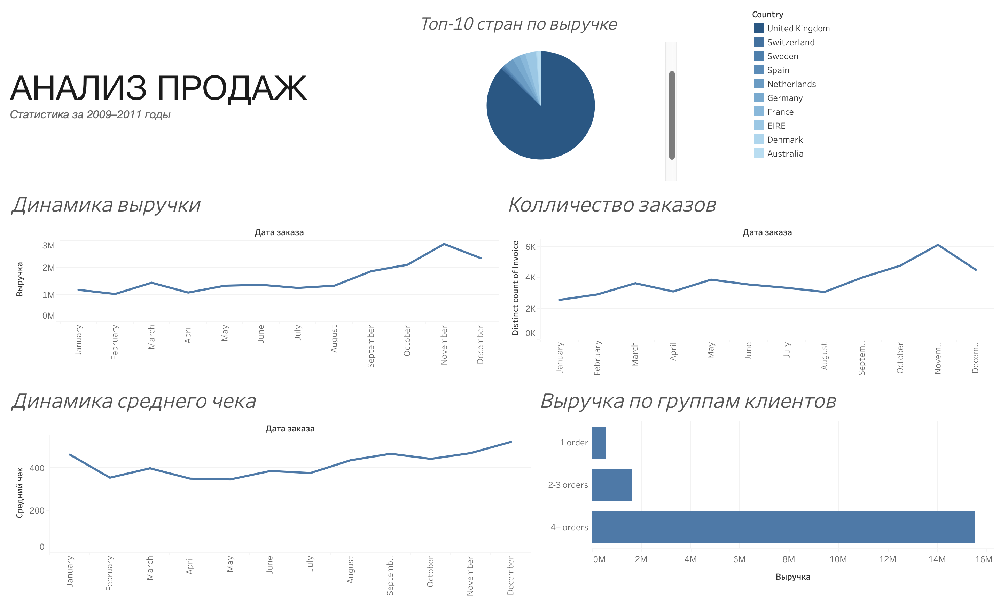

# Анализ выручки и поведения клиентов

Проект по анализу продаж интернет-магазина на основе датасета Online Retail II за 2009–2011 годы.

## Что сделано
- Очистка данных и обработка аномалий.
- Анализ динамики выручки и среднего чека.
- Исследование повторных покупок и клиентских когорт.
- Сегментация клиентов по покупательской активности.
- Проверка гипотез и статистическая оценка результатов.
- Логистическая регрессия для анализа факторов повторной покупки.
- Подготовка данных для визуализации в Tableau.

## Основные результаты
- 69,75% клиентов совершили повторную покупку.
- Средний чек в будни — £493,68, в выходные — £381,18.
- Клиенты с 4 и более заказами приносят в среднем £5 875,58.
- Выручка положительно связана с количеством заказов и уникальных товаров.

## Dashboard

## Стек
Python, pandas, NumPy, SciPy, statsmodels, Matplotlib, Seaborn, Tableau.
